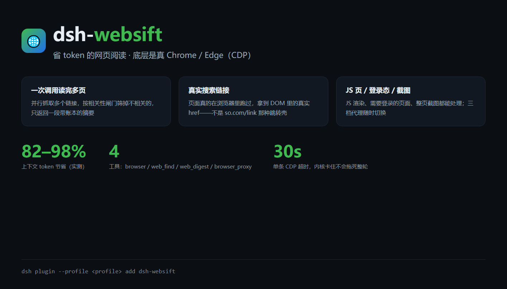
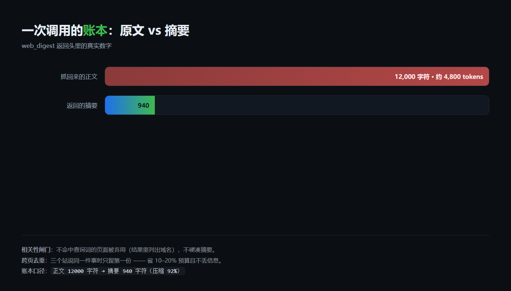

# dsh-websift

**两件事：把网页压成 token，把检索变准。**

| 能力线 | 做什么 |
|---|---|
| **压缩** | 整页正文 → 一段带账本的摘要。按正文字数分档给预算（1200 / 3000 / 4000），抽取式、不调模型，实测压缩 80–98% |
| **检索** | 搜前清洗（去「帮我搜一下」这类壳、拆别名）→ 按标题重合重排、丢首页与符号堆砌 → 抓完按 URL + 正文指纹去重 → 相关性闸门（不命中就明说，不硬凑） |

底座是一颗真 Chrome（headless + CDP）：JS 渲染、登录态、真实搜索结果链接、截图、三档代理。压缩和检索都在**宿主进程**里完成，不额外调用模型 —— 所以省下来的 token 是真省，不是换个地方花。

装一次，四个工具在**每个会话、每个工作区**都有：

```
web_digest     搜索或给定链接 → 抓正文 → 相关性闸门 → 摘要（省 80–98% token）
web_find       真浏览器搜一次，只返回真实链接（不是 so.com/link 那种跳转壳）
browser        打开网址取 JS 渲染之后的内容：正文 / DOM / 截图 / 执行 JS / 弹窗登录
browser_proxy  查看 / 切换 / 探测代理，实时生效，不用重启 DSH
```

[](LICENSE)
[](https://github.com/deepseek-ai)
[](https://github.com/KNLCXY/dsh-websift/releases/latest)
[](https://www.npmjs.com/package/dsh-websift)

---



## 下载

**已在 npm 上**（`dsh-websift`）：直接装就行，不用 clone、不用找包——

```bash
dsh plugin --profile <你的 profile> add dsh-websift
```

也可以去 Release 页拿安装包（`.tgz` 和 `SHA256SUMS.txt` 在同一页）：

**[→ 最新正式版](https://github.com/KNLCXY/dsh-websift/releases/latest)**（也可以看 [全部 Release](https://github.com/KNLCXY/dsh-websift/releases)，含历史预发布）—— 下载其中的 `dsh-websift-<版本>.tgz`（约 100 KB，含 `lib/`、`docs/`、`locale/`、图标）

> 版本口径：**1.x 起是正式版**（Latest）；**0.9.x 及更早都是预发布**，仅作历史留档。

```bash
dsh plugin --profile <你的 profile> add "file:<下载路径>/dsh-websift-<版本>.tgz"
```

校验（同页附件 `SHA256SUMS.txt`）：

```bash
sha256sum -c SHA256SUMS.txt
```

源码可以直接用 Release 页底部的 **Source code (zip / tar.gz)**，也可以 `git clone`。
每个版本都会打 tag（当前 `v1.0.0`，正式版）。0.9.x 及更早是预发布，历史留档。

---

## 目录

- [它解决什么问题](#它解决什么问题)
- [安装](#安装)
- [30 秒验证](#30-秒验证)
- [工具参考](#工具参考)
  - [`browser`](#browser)
  - [`web_find`](#web_find)
  - [`web_digest`](#web_digest)
  - [`browser_proxy`](#browser_proxy)
- [代理：为什么默认是 auto](#代理为什么默认是-auto)
- [省 token 的依据](#省-token-的依据)
- [设置面板与配置文件](#设置面板与配置文件)
- [资源占用与硬约束](#资源占用与硬约束)
- [已知限制](#已知限制)
- [排错](#排错)
- [开发](#开发)
- [许可](#许可)

---

## 它解决什么问题

DSH 自带的 `web_fetch` 是一个 **HTTP 抓取器**：没有 JS 引擎、不保持登录态、不认系统代理。遇到下面这些它就废了，而 agent 最常撞上的恰恰是这些：

| 场景 | `web_fetch` | `dsh-websift` |
|---|---|---|
| 页面靠 JS 渲染（SPA、搜索结果页、文档站） | 只拿到「请启用 JavaScript」空壳 | 真 Chrome 跑完 JS 再取 |
| 搜索结果的跳转壳（`so.com/link?m=…`） | 原样返回壳 | 浏览器点进去，要 DOM 里真实的 `href` |
| 需要登录才能看的内容 | 401 / 登录页 | `browser({action:"login"})` 弹窗登录，cookie 留在插件自己的 profile 里 |
| 被墙的站点 | 直连失败（Node 的 fetch 不读代理环境变量） | 三档代理 + 按域名自动探测 |
| 一次查资料要读 5 个页面 | 5 份全文进上下文，几万 token | `web_digest` 一次调用，只回一段带账本的摘要 |
| 想知道页面长什么样 | 不行 | 整页 PNG 落盘，只返回路径，用 `read_image` 看 |

**核心取舍：只调一次，只回一份。** 每一步操作都返回一份摘要 = 5 步 5 倍 token；所以 `web_digest` 把搜索、抓取、筛选、抽取全放在宿主进程里做完，模型只看到最后那段压缩文本。

## 为什么做成插件，而不是工作区脚本

脚本换个对话、换个工作区就找不到了。插件是 **profile 级**的：装进 `~/.dsh/profiles/<name>/node_modules`，由 DSH 在启动时组装，**每个会话都带着这些工具**，不依赖你把文件放在哪。

---

## 安装

需要 DSH（桌面版或 CLI 均可）和一份本机 Chrome/Chromium。

```bash
# ① 从 npm 装（最省事，版本固定）
dsh plugin --profile <你的 profile> add dsh-websift

# ② 从 git 装（跟随仓库最新）
dsh plugin --profile <你的 profile> add github:KNLCXY/dsh-websift

# ③ 从目录装（要改代码时）
dsh plugin --profile <你的 profile> add "file:/绝对路径/dsh-websift"

# ④ 从打包好的 tgz 装（离线分发）
dsh plugin --profile <你的 profile> add "file:/绝对路径/dsh-websift-<版本>.tgz"
```

**装完必须重启 DSH** —— 插件的宿主半和 client 半都在进程启动时组装一次。

### 内核路径：一般不用改

**留空 = 自动探测。** 插件会按顺序找：

```
环境变量 DSH_CHROME
→ 系统安装的 Chrome / Edge / Brave / Chromium
→ 有界扫描：%LOCALAPPDATA%、%APPDATA%、Program Files、(x86)、~/Desktop、DSH/resources
  （深度 4–5，认识豆包 / 夸克 / 360 / QQ / 搜狗 / UC / 猎豹 / Vivaldi / Opera，
   并要求目录里有 icudtl.dat 或 *.pak 才算真内核）
```

应用内置内核（豆包、夸克等）多是 Electron 套壳：能找到、能选，但可能只打开它自己的界面，
不一定能当浏览器用——优先选标准浏览器。

找不到才需要你手动指一个：

```jsonc
// ~/.dsh/storages/websift/settings.json
{ "chromePath": "C:/Program Files/Google/Chrome/Application/chrome.exe" }
```

或者在 **设置 → 浏览器代理 → 自定义 → 内核路径** 里填（校验 `.exe`）。
状态行会标明当前用的是哪个内核、是不是自动探测来的。

> 没有 Chrome？Edge 也行，Chromium 系的都可以：任何能跑 `--remote-debugging-port` 的内核都能用。

### 其他要改的默认值

| 字段 | 默认 | 说明 |
|---|---|---|
| `proxyUrl` | `http://127.0.0.1:7897` | Clash Verge 的 mixed 端口；没装代理就改成你本机的，或者把 `proxyMode` 设成 `never` |
| `port` | `9333` | CDP 调试端口，别和别的调试端口撞 |
| `proxySites` | github / google / youtube / x … | 命中就直接走代理、不做直连探测。你那边能直连的站点请删掉 |

---

## 30 秒验证

装完重启 DSH，然后让 agent 依次跑：

```js
browser_proxy({ action: "status" })                                  // 看模式、端口、配置文件路径
browser({ url: "https://example.com", action: "eval",
          js: "({t:document.title, links:document.querySelectorAll('a').length})" })
web_digest({ query: "deepseek harness 插件", max_pages: 2, budget_chars: 1200 })
```

正常的话第二次调用会拉起内核（3–6 秒），之后每次 1–3 秒。

---

## 工具参考

### `browser`

用本机 Chrome 内核打开网页，拿 **JS 渲染之后** 的内容。

| 参数 | 类型 | 默认 | 说明 |
|---|---|---|---|
| `url` | string | 必填 | 完整 URL（含 `https://`） |
| `action` | string | `text` | `text` / `html` / `eval` / `screenshot` / `login` |
| `js` | string | — | `action=eval` 时执行的表达式 |
| `wait_ms` | number | `600` | `readyState` 完成后再等多久；SPA 建议 1500–3000 |
| `max_chars` | number | `4000` | 返回文本上限 |
| `proxy` | string | 跟随设置 | 单次覆盖：`auto` / `always` / `never` |
| `full_page` | boolean | `true` | 截图是否整页 |
| `out` | string | `~/.dsh/storages/websift/shots/` | 截图保存路径 |
| `actions` | string | — | **批量动作**（JSON 数组，最多 12 个），在取正文前一次性做完，只返回最终页面 |
| `wait_until` | string | — | `action=login` 时，出现这个 CSS 选择器就算登录成功 |
| `timeout_s` | number | `180` | `action=login` 的等待秒数（最少 20，最多 600） |

**批量动作**是省 token 的关键：点开折叠菜单、滚动到底、再取正文，三步合成一次调用，中间态不回流。

```jsonc
// actions 的语法（按顺序执行，任一失败即停止并报告是哪一步）
[
  { "click": "a.morelink" },          // CSS 选择器，或按钮文字（完全匹配）
  { "wait": 800 },                   // 毫秒
  { "scroll": "bottom" },            // bottom 或像素值
  { "type": { "selector": "#q", "text": "关键词" } }
]
```

**截图**返回的是文件路径，之后用 `read_image` 看 —— 图片不进对话 token。

**登录**（`action: "login"`）会强制打开可见窗口，往页面里注入一条工具条（「✅ 我已登录」/「✕」）。你扫码、填密码、过验证码都行，点一下确认就回传成功。插件**不碰你的密码**，cookie 只留在插件自己的 profile 目录里，后续调用自动带上。它**不会**关掉这个标签页。

### `web_find`

用真浏览器搜一次，**只返回链接清单**（标题 + 真实 URL）。

| 参数 | 默认 | 说明 |
|---|---|---|
| `query` | 必填 | 搜索词。人话会先洗成关键词（「帮我搜一下东风41的射程」→「东风41 射程」） |
| `engine` | `auto` | `auto` 先 Bing → 采用少于 3 条换 Google → 再换百度；也可指定 `bing` / `google` / `baidu` / `360` |
| `aliases` | — | 别名，逗号分隔（最多 4 个），每个别名各搜一轮 |
| `limit` | `8` | 3–15 |
| `proxy` | 跟随设置 | `auto` / `always` / `never` |

它和 `web_search` 的区别：`web_search` 是抓搜索结果页 HTML 再正则解析，拿到的常是跳转壳，点开还是重定向；这里页面真的在浏览器里跑过，`href` 是引擎自己解出来的真实地址。

返回固定抬头：**采用 / 弃用 / 建议深挖**，按「标题与查询词的字面重合」重排，首页、纯域名、符号堆砌这类低质标题会被丢掉。标 ★ 的前 3 条直接丢给 `web_digest({ urls })`，不要换个说法再搜一轮。

### `web_digest`



把「查资料」压成一次调用：搜索（或给定链接）→ 抓正文 → 相关性筛选 → 抽取并合并关键句 → 返回紧凑摘要。

| 参数 | 默认 | 说明 |
|---|---|---|
| `query` | — | 搜索词；给了 `urls` 可省略 |
| `urls` | — | 逗号或空格分隔；跳过搜索，只深挖这些页 |
| `max_pages` | `3` | 1–6；同一站点只取一条，保证来源多样 |
| `budget_chars` | `3000` | 600–20000 |
| `allow_browser` | `true` | HTTP 抓不到时是否升级到真浏览器 |
| `strict` | `false` | 更严：标题与查询词零重合的页不抓；正文须命中 ≥3 词或 ≥45% |
| `links_only` | `false` | 只返回排好序的链接，不抓正文 |

管线（全部在宿主进程里完成，**不调用模型**，所以零额外 token）：

1. **搜前清洗**：去掉「帮我搜一下 / 是什么」这类指令壳；别名（逗号、又名、括号）拆开各搜一轮
2. **去重 + 缓存**：URL 规范化去重；15 分钟缓存、最多 60 条
3. **抓取**：先 `ctx.web.fetch()`（直连、无 JS）→ 失败或只有 JS 空壳 → 真浏览器（auto：直连不通再走代理）
4. **相关性闸门**：正文里真的出现查询词才算命中（≥2 词或 ≥30%）。不相关的页跳过并在头部列出；**一页都不命中时不硬凑摘要**，直接返回按查询词重排的候选链接
5. **抽取**：命中的页面按「查询词命中 + 段落感 + 短行惩罚」挑句子，**相邻句合并成段落**再按原文顺序还原；跨页去重；按预算拼成一段

输出开头自带账本，让你知道这次调用值不值：

```
页面 2/3 成功 · 正文 7735 字符 → 摘要 869 字符（压缩 89%）· 约 3094 → 348 tokens
```

**它是抽取式的，不是重写式的**：挑原句，不生成。代价是句子可能不够连贯，导航多的站点还可能混进噪音（对此有段落感和短行惩罚）。要真正的改写式总结得再过一次模型 —— 那就不是「省 token」了，是「花 token 换可读性」。

**数值豁免**：带单位的数字（`公里 / 千米 / km / 米 / 马赫 / 吨 / kg / MB / GB / TB / ms / %`）即使所在句没命中查询词也会被保留，因为查参数时数字本身就是答案。

### `browser_proxy`

| 参数 | 说明 |
|---|---|
| `action` | `status`（默认）/ `set` / `test` / `stop` |
| `mode` | `action=set` 时：`auto` / `always` / `never` |
| `url` | `action=test` 时：要探测的 URL 或域名 |

```
browser_proxy({ action: "status" })                     // 当前模式 + 浏览器状态 + 端口 + 配置文件
browser_proxy({ action: "test", url: "google.com" })    // 只探测这个域名走哪边
browser_proxy({ action: "set", mode: "always" })        // 切模式，立即生效
browser_proxy({ action: "stop" })                       // 立刻关掉浏览器，释放 ~700MB
```

改动写进 `~/.dsh/storages/websift/settings.json`，**优先级高于插件配置**，不用重启。

---

## 代理：为什么默认是 auto

| 模式 | 行为 |
|---|---|
| `auto`（默认） | 每个新域名先直连探测（HEAD，2.5s）。通 → 直连；不通 → 走代理。结果缓存 10 分钟 |
| `always` | 一律走代理 |
| `never` | 一律直连 |

一刀切为什么不行：国内站点走代理往往更慢，而被墙域名直连会被 DNS 投毒（返回 `69.171.235.22` 这类地址）。所以按域名分别决定，而不是全局开关。

判定顺序：

1. 域名命中 `proxySites` → 直接走代理，不探测
2. `proxyMode = always / never` → 按设置
3. 否则 HEAD 探测直连，TTFB > `probeTimeoutMs`（2500ms）→ 代理
4. 直连页面加载超过 `slowVisitMs`（8000ms）→ 记住这个域名改用代理
5. 代理端口不通（`net.connect` 300ms 探测）→ 回落直连

浏览器侧的代理是 **`--proxy-server` 启动参数**，不是系统代理。所以：即使 Clash 的系统代理开关是关的，插件也能走代理（这也意味着**别的程序**仍然直连）。

---

## 省 token 的依据

`web_digest` 的分级预算不是拍脑袋定的，是三轮基准（32k 字的 Python 文档）跑出来的：

| 长页预算 | tokens | 探针召回 | 每点召回成本 |
|---|---|---|---|
| 全局 1200（旧） | 461 | 28% | 16.5 |
| 2000 | 708 | 33% | 21.5 |
| **3000** | **1165** | **61%** | **19.1** |
| 4000 | 1535 | 67% | 22.9 |

3000 是拐点：再多给 25% 预算只换 6 个百分点，不划算。短/中两档保持 1200 —— 实测给全文贵 2.2 倍只换 11 个点。

按正文字数分档：

| 档位 | 触发 | 单页预算 | 分配方式 |
|---|---|---|---|
| 短 | ≤ 3,000 字 | 1,200（不超过全文） | 全局打分 |
| 中 | 3k – 15k | 1,200 | 全局打分 |
| 长 | 15k – 50k | **3,000** | 前/中/后三段按查询命中加权 |
| 超长 | > 50k | 4,000 | 同上 |

实测压缩比：GitHub 仓库页 7,579 字符 → 759（90%）；两页搜索 7,735 → 869（89%）；单页技术文档常见 82–95%。

---

## 设置面板与配置文件

**设置 → 浏览器代理**（client 半，`lib/client.js`，通过 `settings.section` 插槽注册）：

1. **三个模式**：自动切换 / 强制代理 / 直接连接（点一下立即生效）
2. **自定义**：代理地址（`http://`、`https://`、`socks5://`）、空闲关闭秒数（30–21600）、内核路径（必须 `.exe`）。宿主侧校验，非法值直接 400，不会静默写坏
3. **状态**：浏览器是否运行 / 走不走代理 / 调试端口 / 配置文件路径 / 刷新
4. 输入框右上角还有一个 **关 / 按需 / 强制** 三档开关（`conversation.input.dock` 插槽），按会话记
5. **搜索与抓取来源**一个开关：**关（默认）= 插件自带的真浏览器**；**开 = 官方 API**（搜索走 `ctx.web.search`、抓取走 `ctx.web.fetch`，失败才回退浏览器）

改内核路径或端口会先关掉正在跑的浏览器（旧进程已经不匹配新设置），下次调用按新参数拉起。

全部配置项（`settings.json`，缺失的键用默认值）：

| 键 | 默认 | 说明 |
|---|---|---|
| `chromePath` | — | Chrome/Chromium 可执行文件 |
| `port` | `9333` | CDP 端口 |
| `proxyUrl` | `http://127.0.0.1:7897` | 代理地址 |
| `proxyMode` | `auto` | `auto` / `always` / `never` |
| `proxySites` | `github.com, …` | 强制走代理的域名，逗号或换行分隔 |
| `clashPath` | `''` | Clash Verge 可执行文件；留空 = 自动探测（`DSH_CLASH` 可覆盖） |
| `autoStartClash` | `true` | 代理端口不通时是否自动启动 Clash Verge（30s 冷却） |
| `idleMs` | `300000` | 空闲多久关浏览器（5 分钟） |
| `usage` | `auto` | 输入框开关：`off` / `auto` / `force` |
| `sessionUsage` | `{}` | 按会话覆盖 `usage`（键是 sessionId） |
| `visible` | `false` | 可视模式：窗口常驻不关；开着时**不会**空闲自动关闭 |
| `quiet` | `true` | 仅对可视化模式生效：开=开窗最小化、全程不置前（不抢全屏）；关=每次操作置前，实时可见 |
| `showDock` | `true` | 是否显示输入框旁的小开关 |
| `budgetChars` | `3000` | 摘要总预算 |
| `shortMaxChars` / `midMaxChars` / `hugeMaxChars` | `3000` / `15000` / `50000` | 分档阈值 |
| `shortBudget` / `midBudget` / `longBudget` / `hugeBudget` | `1200` / `1200` / `3000` / `4000` | 分档预算 |
| `factExempt` | `true` | 带单位的数字豁免相关性闸门 |
| `stack` | `plugin` | 两套方案二选一，不混搭：`plugin` = 搜索和抓取都走真浏览器，完全不碰 `ctx.web.*`；`official` = 搜索走 `ctx.web.search`、抓取走 `ctx.web.fetch`（失败才回退浏览器） |
| `cacheTtlMin` / `cacheMax` | `15` / `60` | 页面缓存分钟数 / 条数 |
| `cdpTimeoutMs` | `30000` | 单条 CDP 命令超时（3000–120000）；内核卡住时最多等这么久就报错，不会挂死整轮 |
| `autoMinimizeOnClash` | `true` | 点「启动 Clash Verge」成功后自动最小化浏览器窗口 |
| `pageWaitMs` / `waitMs` | `45000` / `600` | 页面加载上限 / 加载后再等 |
| `routeTtlMin` | `10` | 代理路由结果缓存分钟数 |
| `loginPollMs` / `loginStreak` / `loginTimeoutS` | `1500` / `3` / `180` | 登录轮询间隔 / 连续确认次数 / 超时 |
| `probeTimeoutMs` / `slowVisitMs` | `2500` / `8000` | 直连探测阈值 / 慢站判定 |
| `profileDir` / `outputDir` | `%TEMP%/dsh-websift-profile`、`~/.dsh/storages/websift` | 浏览器 profile / 截图与设置 |

> 每条配置都是「改完即生效」的（下次调用读新值），只有 `chromePath` / `port` 会触发内核重启。

---

## 资源占用与硬约束

- **必须 `--no-sandbox`**：内核放在某些目录（例如桌面应用的 `resources/bin`）下时，Chromium 沙箱读不到自己的可执行文件，报 `Sandbox cannot access executable`。
- **很吃内存**：一次约 16 个进程、700MB。所以默认空闲 5 分钟自动关，下次调用自动拉起（3–6 秒）。急着回收就 `browser_proxy({ action: "stop" })`。
- **标签页复用**：同一个工作标签页会一直复用，不会每次新开又关掉（否则可视窗口里会不停闪 `about:blank`）。
- **cookie 独立**：浏览器用插件自己的 profile（`profileDir`），**不共享你日常 Chrome 的登录态**。要登录就 `action:"login"` 扫一次码，之后长期有效。

## 已知限制

| 限制 | 说明 / 绕法 |
|---|---|
| ~~自动化特征会被站点识别~~ | **0.9.8 已修**：启动参数默认带 `--disable-blink-features=AutomationControlled`，`navigator.webdriver` 不再是 `true`，GitHub 文件编辑器这类页面能正常渲染 |
| 内核启动 3–6 秒 | 首次调用慢；之后复用同一实例 |
| 单页正文上限 | `budget_chars` 最大 20000；再大也不会更准（见上面的基准） |
| 抽取式摘要 | 句子可能不连贯；纯改写式总结需要再过模型 |
| 只处理公开可访问的页面 | 需要短信/扫码的强验证站点要人工介入一次 |
| Playwright 不参与 | 插件不依赖 Playwright/Puppeteer，只用 CDP + Node 内置 `WebSocket`，零运行时依赖 |

---

## 排错

| 现象 | 原因 / 修法 |
|---|---|
| `浏览器没起来（15s 内 CDP 端口无响应）` | `chromePath` 不存在，或端口被占。**设置 → 浏览器代理 → 自定义 → 内核路径** 改掉，或 `browser_proxy({action:"test"})` 看端口 |
| `Sandbox cannot access executable` | 内核在受限目录，必须 `--no-sandbox`（已内置；如果你自己改过启动参数，别删它） |
| `ERR_PROXY_CONNECTION_FAILED` | `proxySites` 里有这个域名，但代理端口没开（Clash 没启动）。要么开 Clash，要么把该域名从 `proxySites` 删掉，或 `proxy:"never"` 单次覆盖 |
| 页面返回 200 但正文很短 | 页面是 SPA 且还在渲染：`wait_ms: 2500` 或用 `action:"eval"` 读 DOM |
| `web_digest` 说「一页都没命中」 | 查询词和正文对不上。看它返回的候选链接，用 `urls` 直接深挖，或换关键词 |
| 设置面板空白 | client 半在进程启动时组装；改了 `lib/client.js` **必须重启 DSH** |
| 改了源码没生效 | pnpm 是**复制**进 `node_modules`，且版本号不变会 "Already up to date"：先 bump `version` 再重装 |

---

## 开发

```bash
# 纯逻辑自测（不开 DSH）：把 lib 里的 @deepseek-ai/dsh-tools 指向 asar 里的真实实现
ELECTRON_RUN_AS_NODE=1 "<DSH 安装目录>/DeepSeek Harness.exe" test/test-offline.mjs

# 其余单测（Node 22+，不需要 DSH）
node --test test/
```

基准脚本在 `bench/`：`bench-final.mjs`（分档预算）、`bench-regimes.mjs`（档位阈值）、`bench-digest.mjs`（摘要质量）、`bench-route.mjs`（代理路由）、`ab-gate.mjs`（相关性闸门）、`reg-fact.mjs`（数值豁免回归）。

**改完源码怎么生效**：

1. bump `package.json` 的 `version`
2. `dsh plugin --profile <profile> add "file:/绝对路径/dsh-websift"`
3. 重启 DSH

运行时的代码是 `node_modules` 里那份，**不是**你改的那份。细节见 [CONTRIBUTING.md](CONTRIBUTING.md)。

架构与内部流程见 [docs/ARCHITECTURE.md](docs/ARCHITECTURE.md)；面向使用者的完整手册（含每个参数的边界值、登录状态机、client/宿主分工）见 [docs/MANUAL.md](docs/MANUAL.md)。

## 依赖与致谢

### Clash Verge（可选依赖，不打包）

插件本身不带代理内核。检测到「代理端口不通」时，会尝试帮你启动 **Clash Verge**：

| 项 | 值 |
|---|---|
| 项目 | [clash-verge-rev/clash-verge-rev](https://github.com/clash-verge-rev/clash-verge-rev) |
| 作者 | zzzgydi 与 [Clash Verge Rev 贡献者](https://github.com/clash-verge-rev/clash-verge-rev/graphs/contributors) |
| 许可 | GPL-3.0 |
| 本插件怎么用它 | 只 `spawn` 它的可执行文件，等待 `proxyUrl` 端口就绪；不修改它的配置、不读取它的订阅 |

- 设置项：`clashPath`（留空自动找）、`autoStartClash`（默认开）
- 面板按钮：**设置 → 浏览器代理 → 启动 Clash Verge**
- 工具动作：`browser_proxy({ action: "clash" })` / `browser_proxy({ action: "clash-start" })`
- 路径探测顺序：`DSH_CLASH` → `%LOCALAPPDATA%\Programs\Clash Verge` → `%LOCALAPPDATA%\Clash Verge` →
  `C:\Program Files\Clash Verge` → `(x86)` → macOS `/Applications/Clash Verge.app`
- 不想让它自动启动：关掉 `autoStartClash`，或把 `proxyMode` 设成 `never`

## 许可

[MIT](LICENSE) © KNLCXY

第三方商标归各自所有者；本项目与 Google / DeepSeek 无隶属关系。
